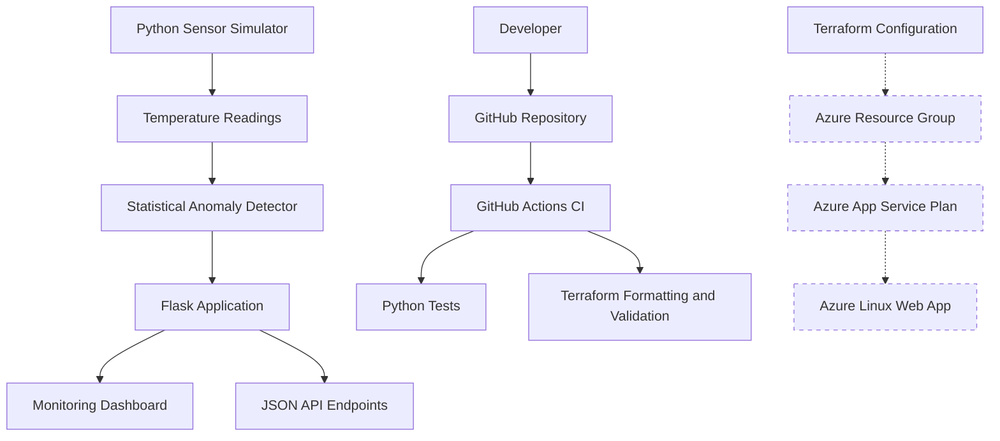

# KimPulse - Cold Storage Monitoring

[](https://github.com/Kim-one/KimPulse/actions/workflows/ci.yml)


KimPulse is a Python-based cold-storage monitoring prototype that simulates temperature readings from multiple storage units and identifies abnormal temperature conditions.

The project demonstrates cloud engineering concepts including infrastructure as code, automated testing, continuous integration, application health checks, monitoring dashboards and troubleshooting.


**Important:** Sensor readings are simulated. KimPulse does not currently connect to physical sensors or collect real-world temperature data.


## Project Overview


Cold-storage environments need consistent temperature monitoring to help prevent food spoilage and equipment-related issues.


KimPulse simulates four storage units, generates temperature readings over a 24-hour period, and identifies potentially unsafe conditions using two statistical detection rules.


The dashboard provides an overview of storage unit conditions, temperature trends and detected anomalies.


### Key Features


- Simulated temperature readings for four storage units.

- 24-hour temperature history with five-minute reading intervals.

- Temperature threshold monitoring.

- Statistical anomaly detection using rolling historical medians.

- Dashboard displaying storage unit status and detected alerts.

- JSON API endpoints for readings, alerts and unit status.

- Application health-check endpoint.

- Automated Python tests using pytest.

- Terraform configuration for Azure infrastructure.

- GitHub Actions CI pipeline for application testing and infrastructure validation.


## Architecture





The Azure infrastructure shown with dashed connections represents the intended deployment architecture. The Azure App Service deployment has not been completed because the subscription has no available F1 quota and is ineligible for a quota adjustment.


## Technology Stack


| Category | Technologies |

|---|---|

| Backend | Python, Flask |

| Data simulation | Python random, datetime |

| Anomaly detection | Python statistics |

| Frontend | HTML, CSS, JavaScript |

| Testing | pytest |

| Continuous Integration | GitHub Actions |

| Infrastructure as Code | Terraform |

| Cloud platform | Microsoft Azure |

| Version control | Git, GitHub |


## How It Works


### 1. Temperature Simulation


The simulator generates readings for four storage units:


- Cooler A: 4.0°C normal temperature

- Cooler B: 4.0°C normal temperature

- Cooler C: 3.5°C normal temperature

- Cooler D: 4.5°C normal temperature


Each unit generates one reading every five minutes for 24 hours.


This produces:


- 288 readings per storage unit.

- 1,152 readings across all four units.

- Three deliberately injected temperature faults.


Random temperature variation is introduced to make the simulated readings more realistic. A fixed random seed makes the generated dataset reproducible.


### 2. Anomaly Detection


The detector uses two statistical rules.


**Rule 1: Temperature Threshold**

Any temperature reading above 8°C is flagged as potentially unsafe.


**Rule 2: Temperature Deviation**

Each reading is compared against the median of the previous 12 readings for its storage unit.

If the temperature differs from that historical median by more than 3°C, it is flagged as an anomaly.

Using the median helps prevent short temperature spikes from significantly affecting the historical baseline.

These are rule-based statistical checks, not a machine-learning model.


### 3. Dashboard and API


The Flask application presents the simulated monitoring results through a web dashboard.


Available endpoints:


| Endpoint | Description |

|---|---|

| `/` | Monitoring dashboard |

| `/health` | Application health check |

| `/api/readings` | All simulated temperature readings |

| `/api/alerts` | Detected abnormal readings |

| `/api/status` | Summary of each storage unit |


Readings are generated when the Flask application starts and held in memory. No database or persistent storage is currently configured.


## Monitoring and Alerting


KimPulse demonstrates basic application and environmental monitoring concepts through:


- Temperature threshold checks.

- Historical temperature deviation detection.

- Per-unit alert counts.

- Storage unit status indicators.

- An alert table showing detected abnormal readings.

- A `/health` endpoint for application health checks.


The dashboard displays simulated monitoring information. It is not currently connected to Azure Monitor, Application Insights or physical monitoring equipment.


## Infrastructure as Code


Terraform is used to define the intended Azure infrastructure.


The configuration includes:


- Azure Resource Group.

- Linux App Service Plan using the F1 tier.

- Azure Linux Web App.

- Python application runtime configuration.

- Application deployment settings.


Terraform formatting and configuration validation are automated through GitHub Actions.


### Azure Deployment Status


The Terraform configuration was successfully initialized and validated.


During deployment, Azure rejected the F1 App Service Plan creation because the subscription had an F1 quota limit of zero.


The subscription was also determined to be ineligible for a quota adjustment.


To maintain the project's zero-cost requirement, the deployment was not upgraded to a paid hosting tier.


The resource group was created, but the App Service Plan and Web App were not successfully provisioned.


The project therefore currently runs locally, with Azure infrastructure defined in Terraform but not fully deployed.


## Continuous Integration


GitHub Actions automatically runs two validation jobs when relevant changes are pushed to the main branch or submitted through a pull request.


**Python Tests**


- Sets up Python 3.12.

- Installs backend dependencies.

- Executes the pytest test suite.


**Terraform Validation**


- Sets up Terraform.

- Checks Terraform formatting.

- Initializes the Terraform providers.

- Validates the Terraform configuration.


Both jobs currently pass successfully.


## Automated Tests


The project includes six automated tests:


| Test | Purpose |

|---|---|

| Normal readings | Confirms normal readings do not generate alerts |

| Injected faults | Confirms deliberately injected faults are detected |

| Alert accuracy | Confirms alerts correspond to injected fault periods |

| Reading interval | Confirms the five-minute reading interval |


Run the tests from the project root:


```powershell

python -m pytest backend/tests/ -v

```


## Running Locally


### Prerequisites


- Python 3.12 or later

- Git


### 1. Clone the repository


```bash

git clone https://github.com/Kim-one/KimPulse.git

cd KimPulse

```


### 2. Create a virtual environment


Windows PowerShell:


```powershell

python -m venv .venv

.venv\\Scripts\\Activate.ps1

```


### 3. Install dependencies


```powershell

pip install -r backend/requirements.txt

```


### 4. Start the Flask application


```powershell

cd backend

python -m flask --app app run

```


### 5. Open the dashboard


Visit:


`http://127.0.0.1:5000`


The API endpoints can also be accessed directly through the browser.


## Future Improvements


Potential extensions include:


- Integrating physical IoT temperature sensors.

- Implementing persistent storage for historical readings.

- Adding real-time data ingestion.

- Integrating Azure Monitor and Application Insights.

- Implementing notification services for temperature alerts.

- Introducing machine-learning anomaly detection using Isolation Forest.

- Deploying the application to an eligible cloud hosting environment.

- Adding authentication and role-based access controls.


## Project Goals


KimPulse was developed as a hands-on cloud engineering portfolio project to explore:


- Python application development.

- Monitoring and anomaly detection.

- Automated testing and continuous integration.

- Infrastructure as Code using Terraform.

- Azure resource provisioning.

- Cloud deployment troubleshooting.


**Author:** Kimone Barrett


**GitHub:** [Kim-one](https://github.com/Kim-one)


**Repository:** [KimPulse](https://github.com/Kim-one/KimPulse)
